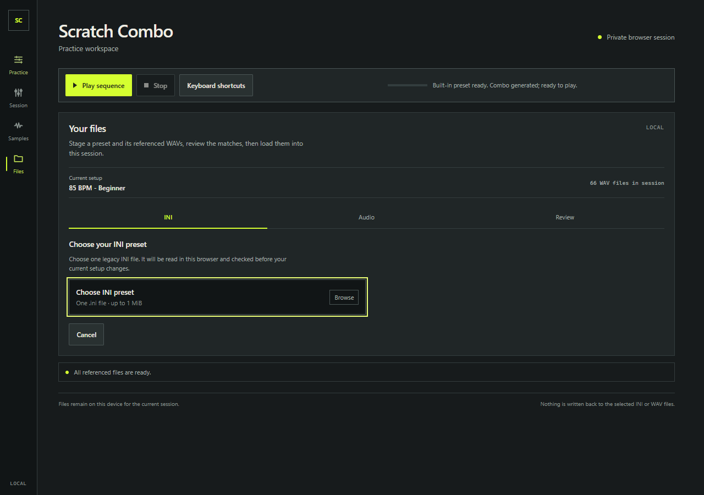
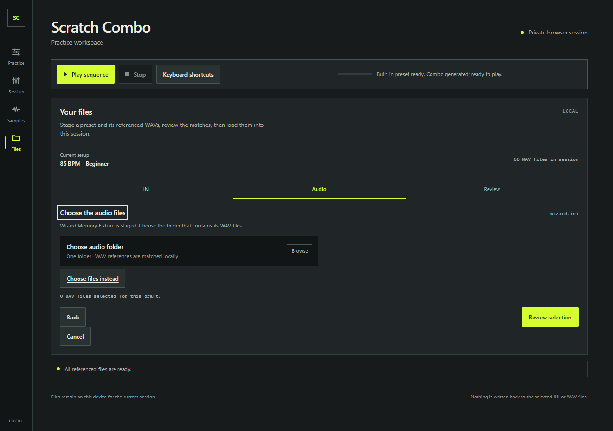
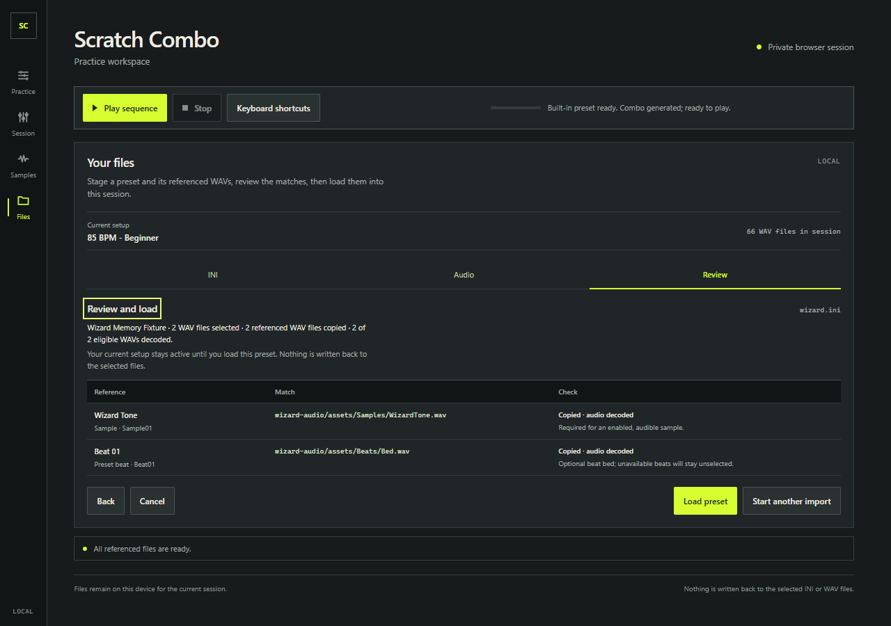
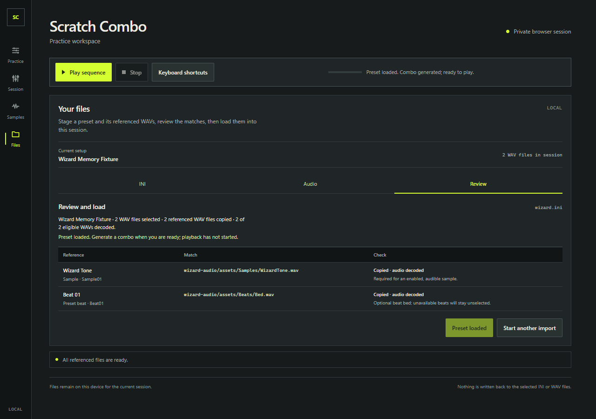

# Local import wizard browser validation

The local preset flow was checked in Edge and Chrome against the development app and the built GitHub Pages preview at `/scratch-combo-web/`. Each test generates its own small INI and PCM WAV files under Playwright's output directory. No recovered or private audio is stored in the repository.

## Coverage

- Import a nested audio folder, review its matched WAVs, load the preset, and keep the committed source bytes in memory. After Load, the test makes the original picker `File` objects fail on `arrayBuffer()` and verifies sample audition, combo generation, sequence playback, nonzero output PCM, and the AudioWorklet continue to work without reading them again.
- Resolve references by selected folder path and basename. The review shows missing references, duplicate basename ambiguity, and a corrupt WAV together; Load stays blocked until the multi-file fallback supplies valid matches.
- Keep the active setup through invalid INI input and until a successful Load. Back preserves staged files, Cancel restores the original Quick preset, and canceling during a delayed snapshot read prevents its late result from changing the setup.
- Load a valid non-repeatable 64-tick sample even when it cannot fill the initial eight-beat length, then select four beats and generate successfully.
- Check that local WAV names never appear in requests and that the production Pages flow makes only same-origin GET/HEAD requests.

## Results

Final unit suite: **193/193 passed** across 15 files. TypeScript and the Pages build passed. The final project-path import/playback checks were rerun in both browsers after the diagnostic-label and wizard-text adjustments.

| Browser check | Edge | Chrome |
| --- | ---: | ---: |
| Import wizard journeys, including memory, playback, repair, cancellation, and short-length compatibility | 6/6 passed | 6/6 passed |
| Production Pages project-path folder import and playback from session snapshots | 1/1 passed | 1/1 passed |
| Migrated sample editor and saved INI round trip | 1/1 passed | — |

The Pages check ran against the production preview on port 4174 using `playwright.pages.config.ts`; it does not rebuild `dist`.

## Production Pages evidence

The screenshots below show the production preview. Chrome produced the same four states; its copies are linked below each image.

### Step 1: choose the INI

[Chrome capture](images/import-wizard-step-1-chrome.png)

### Step 2: choose the audio folder

[Chrome capture](images/import-wizard-step-2-chrome.png)

### Review matches before Load

[Chrome capture](images/import-wizard-review-chrome.png)

### Loaded preset

[Chrome capture](images/import-wizard-loaded-chrome.png)

## Test sources

- [Import wizard browser tests](../e2e/import-wizard.spec.ts)
- [Generated INI and WAV fixtures](../e2e/fixtures/import-wizard-fixtures.ts)
- [Production Pages import smoke](../e2e/pages-base.spec.ts)
- [Migrated sample editor and INI save flow](../e2e/integrated-session-editor.spec.ts)
