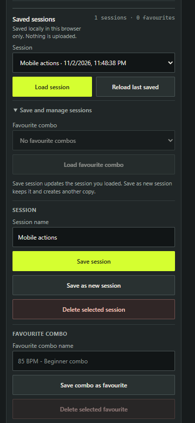
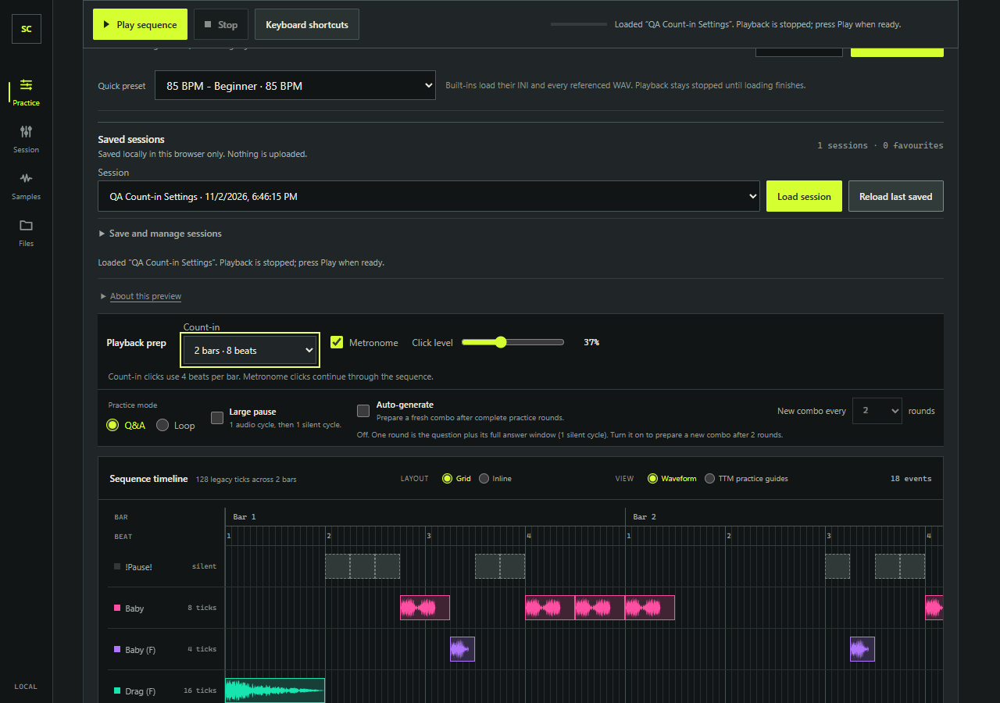
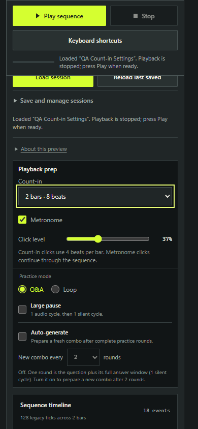
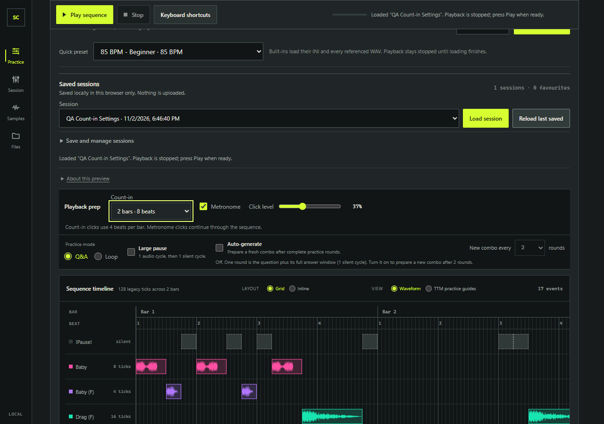
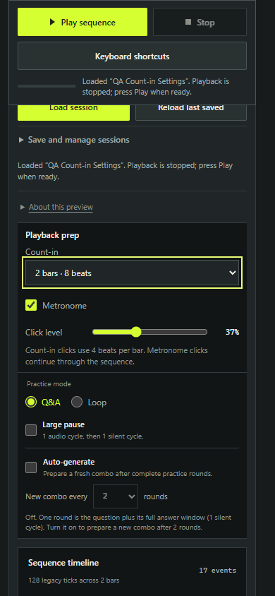

# Count-in and metronome QA evidence

## Mobile overlap correction

The playback dock now scrolls in the normal page flow at widths up to 760px. This prevents the tall mobile bar from covering saved-session controls; desktop keeps its sticky dock. A focused 390×844 regression failed with the original sticky rule and passes in Edge and Chrome after the fix, checking Load/Reload/Save/Delete visibility, pointer hit targets, focusability and separation from the dock. The Pages build also passes.



- Date: 2026-11-02
- Runtime: portable Node.js v24.22.2
- Browser runs: Microsoft Edge and Google Chrome, Playwright channels
- Isolated origin: `http://127.0.0.1:4182/`; the QA config derives `baseURL` from its port setting and uses a strict, non-reused dev server. The repository's default Playwright config was not changed.

## Browser runs

The focused two-journey suite passed on both browsers after the final source freeze:

| Browser | Result | Duration |
| --- | --- | --- |
| Edge | 2 passed | 23.2 s |
| Chrome | 2 passed | 23.1 s |

Run from the repository root in PowerShell with the portable Node 24 binary:

```powershell
$node = 'C:\Users\peter\source\repos\ScratchComboRecovery\tooling\node-24.22.2\node-v24.22.2-win-x64\node.exe'
$env:PLAYWRIGHT_CHANNEL = 'msedge' # Use 'chrome' for Chrome.
& $node .\node_modules\@playwright\test\cli.js test --config .forge\playwright-count-in.config.ts
```

The local `.forge/playwright-count-in.config.ts` selects only `e2e/count-in-metronome.spec.ts`, uses one worker, and writes traces/results below `.forge/count-in-qa-results/<browser>/`. The isolated run left the shared development servers untouched.

## Integrated journeys

| Journey | Evidence |
| --- | --- |
| Count-in, Stop, trimmed beat, and Auto-generate | Confirmed defaults (count-in Off, metronome Off, level 60), then verified Off starts without a countdown and starts the trimmed beat at its 1 s cue. During a 2-bar/8-beat pre-roll, status showed beat 1 of 8, progress stayed at zero, no playhead appeared, and Stop canceled queued future beat/click nodes before their scheduled starts; no new sources appeared during the following 3.1 s. A 1-bar run then verified the four-beat pre-roll, accented 1760 Hz downbeat and 1320 Hz regular clicks, live click level 40%, retained beat trim, and 170→160 BPM rephasing. Auto-generate reached the next plan (combo 2, global cycle 3) with no repeated count-in status. **Pass** |
| Saved preferences, legacy restore, and responsive controls | Saved 2 bars / metronome On / level 37, reloaded and restored all three values, removed those fields from the saved legacy fixture, then confirmed legacy restore defaults to Off / Off / 60. Captured desktop and 390×844 viewport screenshots with the full Playback prep group centered and all controls visible; the focused control was Count-in and the viewport had no horizontal overflow. **Pass** |

## Audio timing observation

The browser probe wrapped native `AudioBufferSourceNode.start()` and `OscillatorNode.start()`, observed node connections, and sampled Analyser output on the click path and processed beat worklet path. With the processor's estimated 130 ms presentation delay, the trimmed beat source was scheduled 130 ms before the matching sequence click. The first non-silent processed-beat Analyser sample was compared with the first non-silent matching click sample:

| Browser | Processed beat PCM onset minus click PCM onset | Allowed tolerance |
| --- | ---: | ---: |
| Edge | −18.67 ms | ±100 ms |
| Chrome | −10.67 ms | ±100 ms |

Both observed deltas passed the browser check. This is an in-browser graph/Analyser observation using the generated WAV fixture; it does not measure physical speaker or headphone timing or establish hardware playback accuracy. The detailed per-run timestamps, oscillator frequencies, gain, and click intervals are retained in the ignored `.forge/count-in-qa-results/{edge,chrome}/audio-timing.json` files.

## Screenshots

The desktop and mobile captures show the saved 2-bar, metronome-on settings at 37% click level.

| Browser | Desktop 1280×900 | Mobile viewport 390×844 |
| --- | --- | --- |
| Edge |  |  |
| Chrome |  |  |
