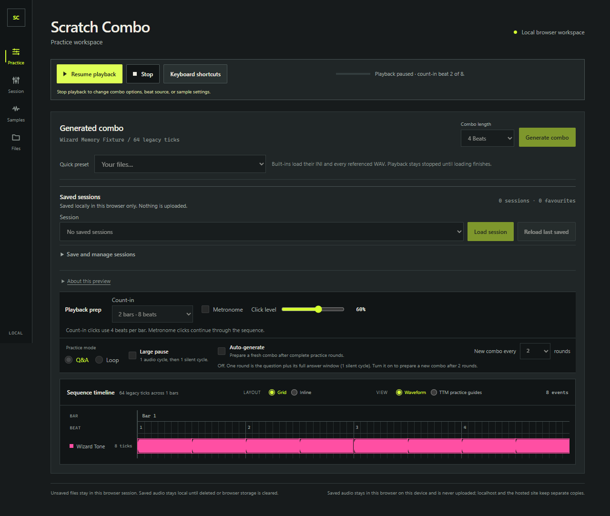
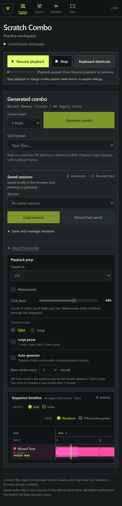
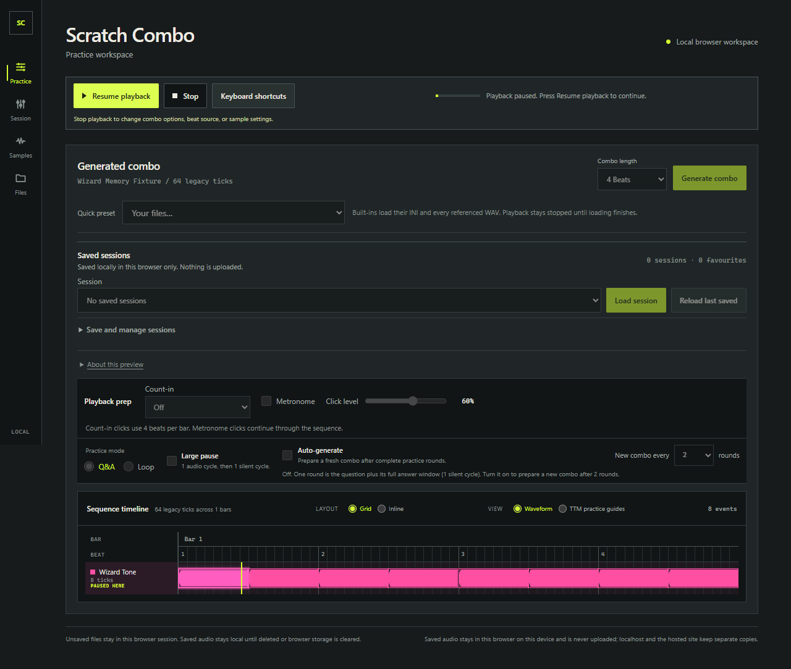
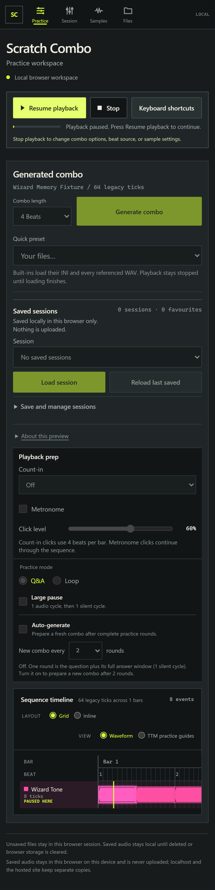
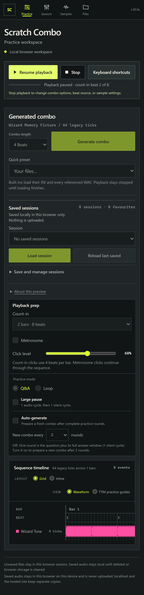

# Pause and resume QA evidence

- Date: 2026-11-03
- Runtime: portable Node.js v24.22.2
- Isolated origin: `http://127.0.0.1:4184/`; a strict, non-reused dev server was used without changing the normal Playwright config or shared servers.
- Browser coverage: Microsoft Edge and Google Chrome, each at desktop size and Pixel 7 mobile emulation.

## Browser runs

The focused two-journey suite passed in all four contexts:

| Browser context | Result | Duration |
| --- | --- | ---: |
| Edge desktop | 2 passed | 14.9 s |
| Edge Pixel 7 emulation | 2 passed | 14.8 s |
| Chrome desktop | 2 passed | 14.7 s |
| Chrome Pixel 7 emulation | 2 passed | 14.6 s |

Run from the repository root in PowerShell with the portable Node 24 binary:

```powershell
$nodeExe = 'C:\Users\peter\source\repos\ScratchComboRecovery\tooling\node-24.22.2\node-v24.22.2-win-x64\node.exe'
$env:PATH = (Split-Path -Parent $nodeExe) + ';' + $env:PATH
$env:PLAYWRIGHT_CHANNEL = 'msedge' # Set to 'chrome' for Chrome.
Remove-Item Env:\PLAYWRIGHT_MOBILE -ErrorAction SilentlyContinue
& $nodeExe .\node_modules\@playwright\test\cli.js test --config .forge\playwright-pause-resume.config.ts

# Repeat the same command with mobile viewport emulation enabled.
$env:PLAYWRIGHT_MOBILE = '1'
& $nodeExe .\node_modules\@playwright\test\cli.js test --config .forge\playwright-pause-resume.config.ts
```

The local `.forge/playwright-pause-resume.config.ts` selects only `e2e/pause-resume.spec.ts`, uses one worker, and writes results under `.forge/pause-resume-results/`. It reserves port 4184 and does not reuse or stop another server.

## Journeys

| Journey | Result |
| --- | --- |
| Pause, freeze, resume, and Stop while paused | Started a locally imported WAV fixture, waited for the native `AudioContext` clock and timeline progress to advance, then paused. Across a 450 ms hold, the context stayed suspended, clock and progress remained within their set tolerances, and no additional sample or oscillator sources were started. Resume kept the same context and progressed from the paused position. A second pause followed by Stop reset progress and did not schedule more sources. **Pass in all four contexts.** |
| Pause during count-in and resume | Started an 8-beat pre-roll, paused after beat 1, and confirmed the paused count remained stable while the context was suspended. On resume, the count-in advanced without returning to beat 1, then the timeline began. **Pass in all four contexts.** |

The test observes browser Web Audio state and progress; it does not measure sound from physical speakers or headphones. Mobile runs use Pixel 7 viewport/touch emulation in desktop Edge and Chrome, not a physical phone.

## Screenshots

| Context | Playback paused | Count-in paused |
| --- | --- | --- |
| Edge desktop |  |  |
| Edge mobile |  |  |
| Chrome desktop |  |  |
| Chrome mobile |  |  |
