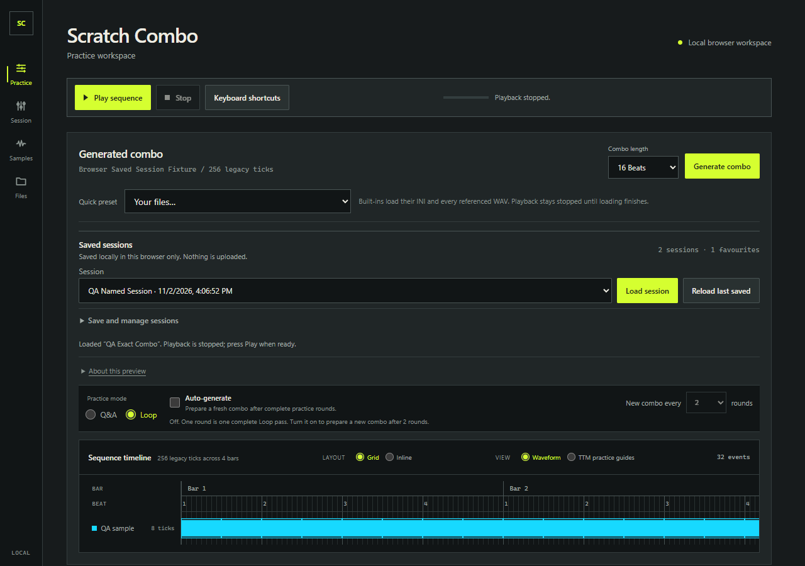
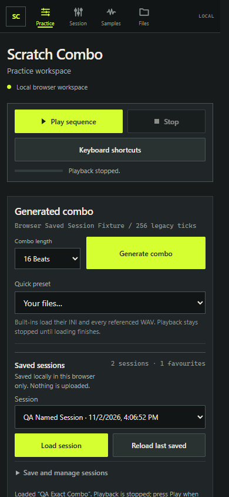
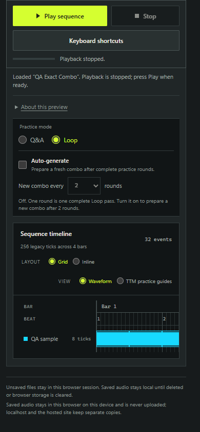

# Saved sessions QA evidence

- Date: 2026-11-02
- Workspace: local `ScratchComboWeb`; default E2E origin `http://127.0.0.1:4173/`, isolated QA origin `http://127.0.0.1:4180/`
- Runtime: portable Node.js v24.22.2
- Browsers: Microsoft Edge and Google Chrome through Playwright

## Browser runs

The focused suite passed with the repository's default config and with an isolated 4180 config. The spec does not set its own `baseURL`; network checks derive the allowed origin from the current page URL. Playwright used one worker, and the existing 4173 and 4175 listeners remained active during isolated runs.

| Run | Result |
| --- | --- |
| Default config, Edge on 4173 | 3 passed in 20.3s |
| Isolated config, Edge on 4180 | 3 passed in 20.1s |
| Isolated config, Chrome on 4180 | 3 passed in 20.2s |

The exact command was:

```powershell
$nodeDir = 'C:\Users\peter\source\repos\ScratchComboRecovery\tooling\node-24.22.2\node-v24.22.2-win-x64'
$env:PATH = "$nodeDir;$env:PATH"
# Default project config, Edge, existing 4173 server
Remove-Item Env:\PLAYWRIGHT_CHANNEL -ErrorAction SilentlyContinue
npm.cmd run test:e2e -- 'e2e/saved-sessions.spec.ts' --workers=1

# Dedicated isolated config, Edge, port 4180
npm.cmd run test:e2e -- --config '.forge/playwright-sessions.config.ts' --workers=1

# Dedicated isolated config, Chrome, port 4180
$env:PLAYWRIGHT_CHANNEL = 'chrome'
npm.cmd run test:e2e -- --config '.forge/playwright-sessions.config.ts' --workers=1
```

`.forge/playwright-sessions.config.ts` is gitignored local QA support that matches the repository Playwright defaults while selecting only this spec and using port 4180. The normal `npm run test:e2e` path continues to use `playwright.config.ts` on port 4173.

## Coverage and results

| Journey | Evidence |
| --- | --- |
| Named session and favourite combo | Saved a custom INI fixture and three WAV assets, created a second named copy, changed the active controls/combo, loaded the first record, and reloaded the last saved session after a page refresh. The ordered accessible event list matched exactly; BPM 99, pitch +3, levels 93/90, Loop mode, beat-bed selection, source metadata, and stopped transport were restored. The original record remained after Save as new. The three persisted WAV Blobs matched their source SHA-256 digests; the selected sample and preset beat decoded and produced a looped source on explicit Play. Deleting both sessions and the favourite persisted across reload. **Pass** |
| Invalid record handling | Changed the saved record's `snapshot.comboBeats` to invalid value `3`, then attempted to load it after a reload. The app showed its invalid-settings alert and kept the active event list and controls intact; playback stayed stopped. **Pass** |
| Uploaded custom beat | Uploaded and applied a 128 BPM WAV through the Session tab's Custom beat control, saved a named session, and used Reload last saved after a page refresh. Custom source mode, recorded BPM, and working BPM returned at 128. The saved Blob SHA-256 matched the uploaded file, the file was decoded after reload, and explicit playback produced custom-beat worklet output RMS greater than 0.001. Restore did not resume audio or start sources. **Pass** |

The two network-audited journeys asserted that requests stayed on the current page's origin (4173 with the default config, 4180 with isolated config) and used GET/HEAD only. No hosted mutations were made. These E2E cases did not enable TTM or use audio export.

## Responsive screenshots

These captures use the Edge desktop browser with Playwright viewport sizes. The mobile captures are viewport emulation, not a physical phone.







The initial mobile view shows the quick session selector and Load/Reload actions with the management disclosure collapsed; the timeline is reachable by scrolling. The viewport checks cover 1280×900, 844×900, and 390×844 widths/heights and verify no horizontal overflow or clipped session controls.

## Scope limits and adjacent evidence

The audio check reads RMS from a browser Web Audio analyser connected to the custom beat worklet. It confirms decoded, nonzero in-browser output; it does not verify headphones, speakers, or other physical audio hardware. Responsive checks use a desktop Edge/Chrome browser context with resized viewports; no physical or mobile-browser hardware was available.

Separately, root reported two passing Pages2 Edge checks: TTM-gated Grid/Inline worklet behaviour and import-folder memory/playback. Those checks are outside `e2e/saved-sessions.spec.ts` and are recorded here as separate evidence.
