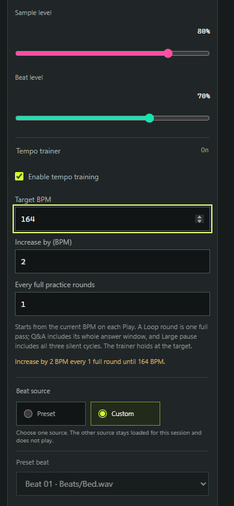
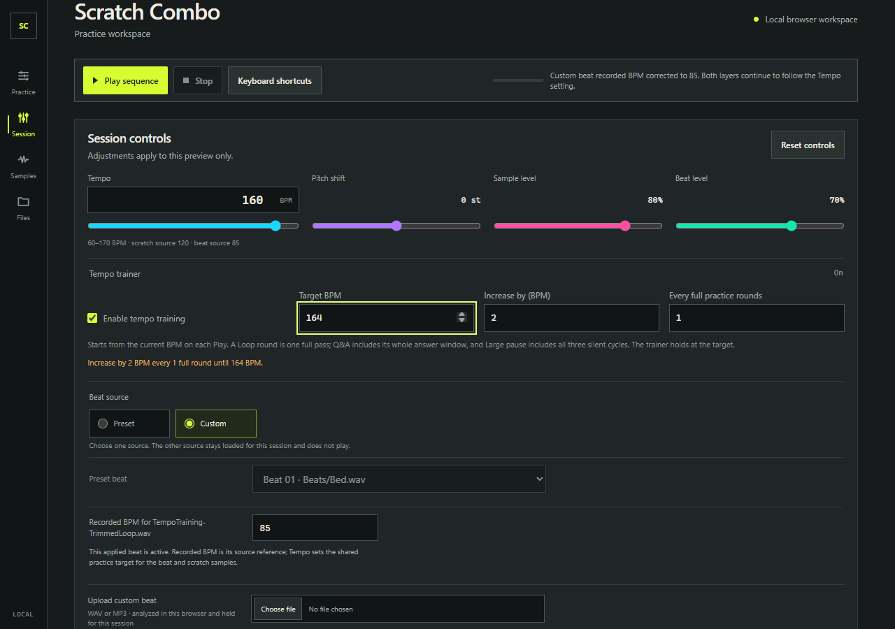
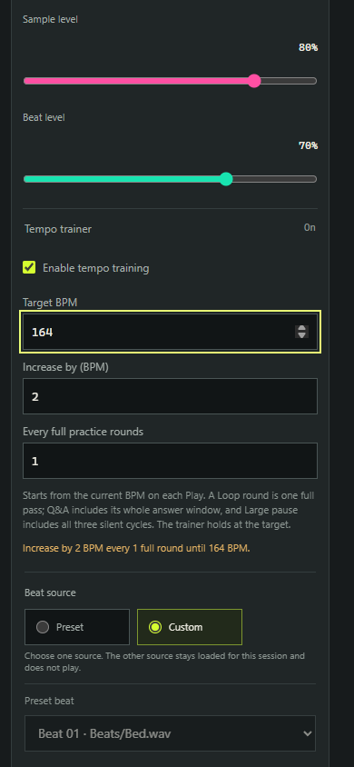

# Tempo training browser validation

Final browser validation used the isolated `.forge/playwright-tempo-training.config.ts` config on port 4183 with Node 24.22.2. It ran serially after the audio and UI sources were frozen.

## Results

| Browser | Loop journey | Q&A journey |
| --- | --- | --- |
| Microsoft Edge | Passed (14.0s) | Passed (37.9s) |
| Google Chrome | Passed (13.0s) | Passed (36.8s) |

The Loop journey verified full-cycle steps from 160 to 170 BPM, target clamping, no count-in, one continuously looping trimmed beat, and metronome continuity and live level adjustment. The Q&A journey verified three silent Large-pause answer cycles without an early step, a step only after the complete answer window, manual BPM cancellation, Stop and Play re-arming from the manual tempo, one count-in per Play, settings persistence, legacy missing-field defaults, and target validation after changing the beat reference range.

## Boundary observations

The scheduled input boundary is derived from the Web Audio beat source start and full fixture cycle duration. The presentation estimate adds 130 ms, the configured processor/output-latency estimate. The observed time is when the tempo status update was recorded on the AudioContext clock. The transport snapshot scheduler runs at 25 ms; the DOM status observer checks every 10 ms and records status mutations. These figures measure status-update timing against the estimated presentation boundary, not physical speaker output or PCM onset.

| Browser | Journey boundary | Scheduled input (s) | Presentation estimate (s) | Status observed (s) | After input (ms) | After presentation estimate (ms) |
| --- | --- | ---: | ---: | ---: | ---: | ---: |
| Edge | Loop first step | 1.6407 | 1.7707 | 1.8400 | 199.3 | 69.3 |
| Edge | Q&A first step | 7.6700 | 7.8000 | 7.8720 | 202.0 | 72.0 |
| Edge | Q&A re-arm to target | 21.6226 | 21.7526 | 21.8213 | 198.7 | 68.7 |
| Chrome | Loop first step | 1.6513 | 1.7813 | 1.8720 | 220.7 | 90.7 |
| Chrome | Q&A first step | 7.6513 | 7.7813 | 7.8507 | 199.3 | 69.3 |
| Chrome | Q&A re-arm to target | 21.6520 | 21.7820 | 21.8400 | 188.0 | 58.0 |

The observed status arrived after each estimated presentation boundary. The measured post-estimate interval ranged from 58.0 to 90.7 ms in these runs; it is an observed status arrival interval, not an audio-output latency measurement.

## Session control screenshots

The trainer is expanded in Session at 1280×900 desktop and 390×844 mobile viewports.

| Browser | Desktop | Mobile |
| --- | --- | --- |
| Edge |  |  |
| Chrome |  |  |

## Commands

PowerShell commands used from the repository root:

```powershell
$env:PATH='C:\Users\peter\source\repos\ScratchComboRecovery\tooling\node-24.22.2\node-v24.22.2-win-x64;'+$env:PATH
Remove-Item Env:PLAYWRIGHT_CHANNEL -ErrorAction SilentlyContinue
node_modules/.bin/playwright.cmd test --config .forge/playwright-tempo-training.config.ts --workers=1
```

The same command was used for Chrome after setting:

```powershell
$env:PLAYWRIGHT_CHANNEL='chrome'
```

Each browser run reported `2 passed`. The focused config and machine-readable timing results are local ignored `.forge` artifacts; the screenshots above are durable documentation assets.
